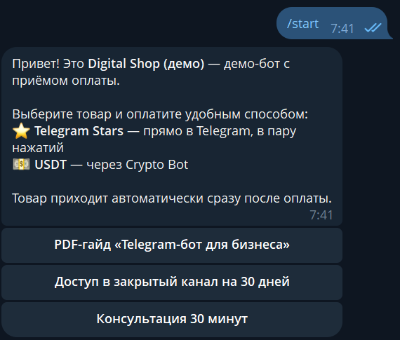
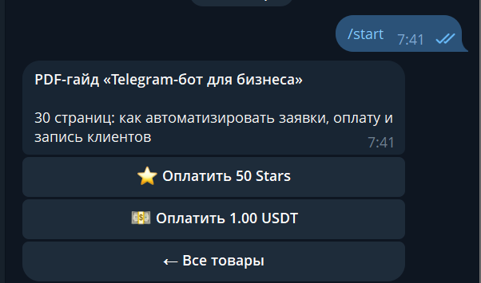
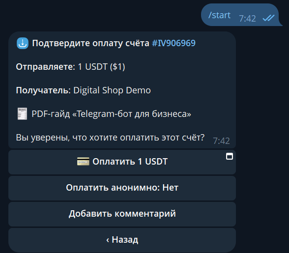
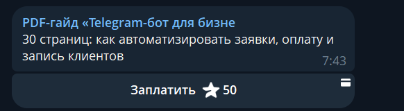
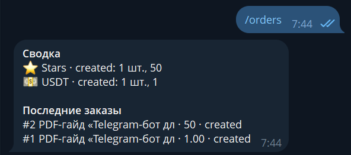

# Payments Bot — Telegram Stars & USDT (Crypto Bot)

A Telegram shop bot that accepts payments in **Telegram Stars** and **USDT** via Crypto Bot (Crypto Pay API) and delivers the product automatically right after payment.

Built by someone who handles payments for a living (L2 Payment Support: cards, e-wallets, crypto deposits) — so the edge cases are covered: duplicate payment notifications, expired invoices, refunds, payment provider downtime.

👉 **Try it live:** [@artmin_shop_demo_bot](https://t.me/artmin_shop_demo_bot) (USDT payments run on the Crypto Bot testnet)


## ✨ Features

- 🛍 **Product catalog** with inline buttons — all products and prices in one file ([`catalog.py`](catalog.py))
- ⭐ **Telegram Stars** — native Telegram invoice, pay in two taps; pre-checkout validation
- 💵 **USDT via Crypto Bot** — invoice with a pay button, automatic status tracking every 15 s
- 📦 **Automatic delivery** — file, link, invite or message sent right after payment
- 🛡 **Delivered exactly once** — the order moves to `paid` atomically, so a repeated payment notification never delivers twice
- ⌛ **Expired invoices** — the customer is notified and offered to create a new order
- ↩️ **Refunds** — `/refund <order>` returns Stars to the customer
- 🔔 **Admin notifications** about every payment + `/orders` summary by method and status
- 🧪 **Testnet support** — try USDT payments with test coins before going live

## 🔄 Order lifecycle

```
created ──► paid ──► (refunded)
   │
   └──► expired / error
```

## 📸 Screenshots

| Catalog | Product: pay with Stars or USDT | USDT invoice in Crypto Bot |
|---|---|---|
|  |  |  |

| Telegram Stars invoice | Admin: /orders summary |
|---|---|
|  |  |

## 🚀 Run

```bash
python -m venv .venv
.venv\Scripts\activate
pip install -r requirements.txt
copy .env.example .env     # BOT_TOKEN, ADMIN_CHAT_ID, CRYPTO_PAY_TOKEN
python bot.py
```

- Stars work out of the box — no payment provider token needed.
- For USDT: create an app in Crypto Bot (or the testnet bot for testing) → Crypto Pay → Create App, put the token into `CRYPTO_PAY_TOKEN`. Without it the bot works with Stars only.

## 🔄 Adapting

Products, prices and what gets delivered live in `catalog.py`. Easy to extend: subscriptions with expiry, one-time invite links to a private channel, other crypto assets (TON, BTC), card payments via a local payment provider.

---

## 🇷🇺 Кратко по-русски

Telegram-бот-магазин с приёмом оплаты в **Telegram Stars** и **USDT** (Crypto Bot). Товар выдаётся автоматически сразу после оплаты. Учтены реальные платёжные ситуации: повторные уведомления об оплате (товар не выдаётся дважды), истёкшие счета, возвраты, недоступность платёжного сервиса. Админ получает уведомления о каждой оплате и сводку по заказам.
